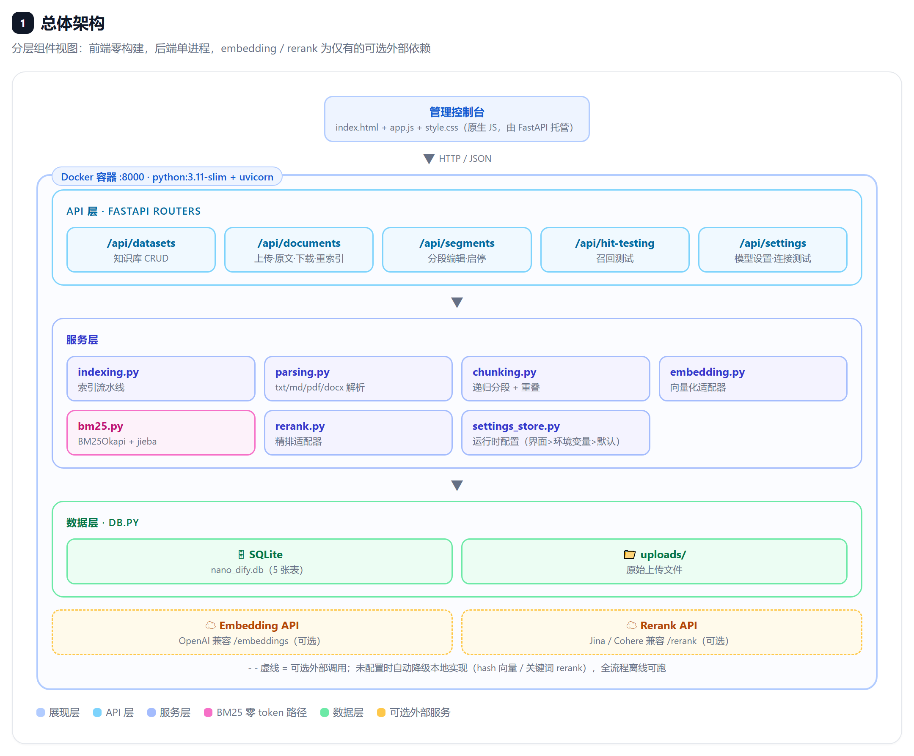
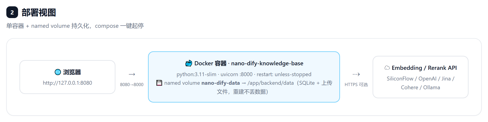
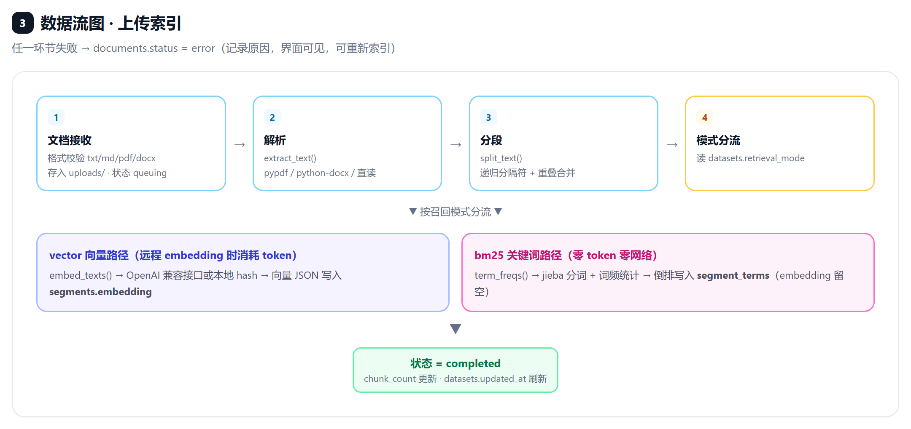
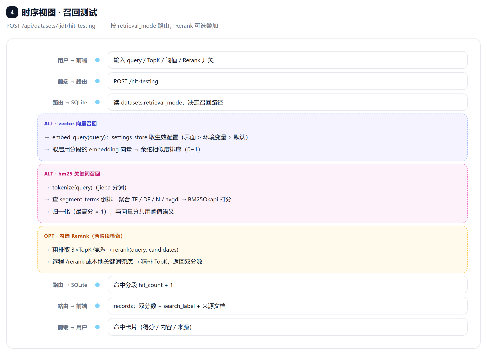
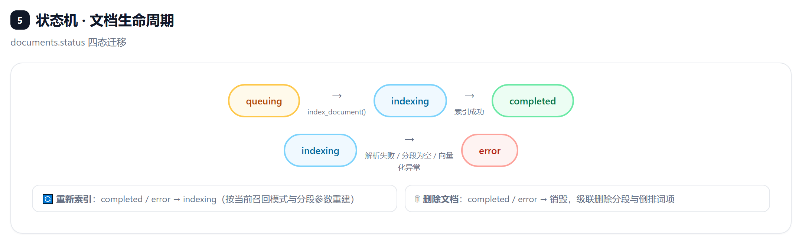
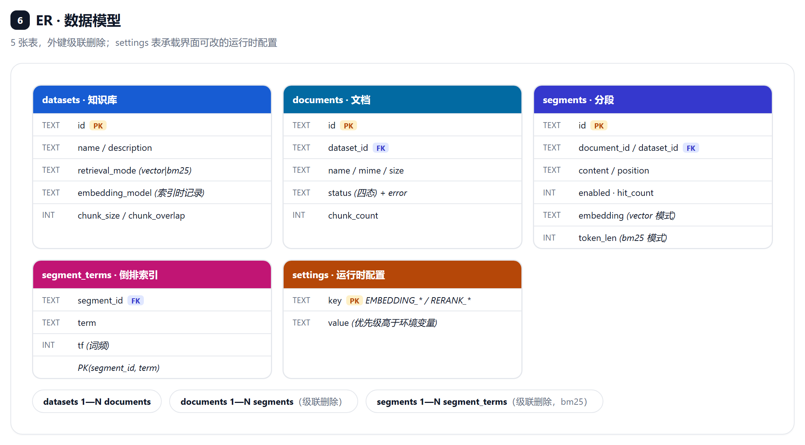

# Nano Dify Knowledge Base

参考开源项目 [Dify](https://github.com/langgenius/dify) 的**知识库（Dataset）**模块，
独立实现的一个迷你版本：只包含知识库本身及其管理界面，单进程、零中间件、开箱即用。

> 本仓库为原创代码，不包含 Dify 源码。许可证与归属说明见下方 [许可证](#许可证)。

## 功能

- **知识库管理**：新建 / 重命名 / 删除知识库，配置分段长度与重叠
- **文档管理**：上传 `txt / md / pdf / docx`，自动解析、分段、向量化；支持查看原文、下载原始文件、重新索引与删除
- **分段管理**：查看分段内容、在线编辑（自动重新向量化）、启用 / 禁用、手动新增、删除，统计命中次数
- **召回测试**：输入问题即时检索，返回 TopK 命中分段、来源文档与相似度得分，支持得分阈值过滤
- **两种召回方式（知识库级别可选）**：
  - **向量检索**：语义匹配，配置 OpenAI 兼容接口（`EMBEDDING_BASE_URL` + `EMBEDDING_API_KEY` + `EMBEDDING_MODEL`，或界面「⚙ 模型设置」）即用真实语义向量；不配置时降级为本地 Hash Embedding（仅供演示）
  - **BM25 关键词检索**：纯本地、零 token、零网络；jieba 中文分词（未装时退化为字 bigram），倒排索引存 SQLite，分数归一化到 0~1
  - 两种方式都可叠加 **Rerank** 精排（两阶段：粗排 3×TopK 候选 → 精排 TopK）

## 技术栈

| 层 | 选型 |
|---|---|
| 后端 | FastAPI + SQLite（单文件库，无外部服务依赖） |
| 前端 | 原生 HTML / CSS / JS 管理界面，由后端直接托管 |
| 向量检索 | 余弦相似度（纯 Python 实现） |

## 架构设计

> 七视图高清图源为手工排版的 HTML（[docs/architecture.html](docs/architecture.html)，可直接在浏览器打开交互预览），
> 截图为 2x 高清 PNG，存放于 [docs/diagrams/](docs/diagrams)。

### ① 总体架构

分层组件视图：前端零构建，后端单进程，embedding / rerank 为仅有的可选外部依赖（未配置时自动降级本地实现，全流程离线可跑）。



### ② 部署视图

单容器 + named volume 持久化（SQLite 库 + 上传文件），`docker compose up -d` 一键起停，重建不丢数据。



### ③ 数据流图 · 上传索引

文档接收 → 解析 → 分段 → 按召回模式分流：vector 走向量化写 `segments.embedding`，bm25 走 jieba 分词写倒排表 `segment_terms`（零 token 零网络）。任一环节失败 → `documents.status = error`，界面可见并可重新索引。



### ④ 时序视图 · 召回测试

`POST /api/datasets/{id}/hit-testing` 按 `retrieval_mode` 路由：vector 走余弦相似度，bm25 走 BM25Okapi 打分（归一化到 0~1，与向量分共用阈值语义）；勾选 Rerank 时两阶段检索（粗排 3×TopK 候选 → 精排 TopK，返回双分数）。



### ⑤ 状态机 · 文档生命周期

`queuing → indexing → completed / error` 四态迁移；重新索引回到 indexing；删除文档级联清除分段与倒排词项。



### ⑥ ER · 数据模型

5 张表：`datasets 1—N documents 1—N segments 1—N segment_terms`，外键级联删除；`settings` 表承载界面可改的运行时配置。



### ⑦ 设计决策

1. **召回模式双轨**：vector（语义，花 token）与 bm25（精确词，零 token）在知识库级别二选一；索引流水线在分段后分流，共用分段 / 文档 / 召回测试 / Rerank 框架
2. **配置三级优先级**：界面设置（DB）> 环境变量 > 内置默认；密钥脱敏展示、永不回传明文
3. **DB 锁纪律**：所有网络调用（embedding / rerank）在 SQLite 锁外执行——实测踩过锁重入死锁后定下的规矩
4. **已知边界**：BM25 不做语义泛化（同义改写查不到）；hybrid 融合召回留二期，`search_label` / 双分结构已预留位置

## 快速开始

### 方式一：本地运行

```bash
pip install -r backend/requirements.txt
python run.py
```

打开 <http://127.0.0.1:8000> 即可进入管理界面；API 文档见 <http://127.0.0.1:8000/docs>。

### 方式二：Docker 部署（推荐）

```bash
# 一键构建并启动
docker compose up -d --build

# 查看日志 / 停止
docker compose logs -f
docker compose down
```

打开 <http://127.0.0.1:8080> 进入管理界面（compose 默认映射宿主机 `8080` → 容器 `8000`，
如 8000 空闲可自行改回 `8000:8000`）。

数据持久化在 named volume `nano-dify-data`（SQLite 库 + 上传文件），容器重建不丢数据；
`docker compose down -v` 会连数据一起删除。

不使用 compose 也可以直接构建镜像：

```bash
docker build -t nano-dify-knowledge-base .
docker run -d --name nano-dify-knowledge-base -p 8080:8000 \
  -v nano-dify-data:/app/backend/data nano-dify-knowledge-base
```

网络受限环境下可用构建参数指定 PyPI 镜像加速：

```bash
docker compose build --build-arg PIP_INDEX_URL=https://pypi.tuna.tsinghua.edu.cn/simple
```

### 接入 Embedding 服务（可选）

**推荐：在界面配置**。侧边栏底部「⚙ 模型设置」中填写 Base URL / API Key / 模型名，
保存立即生效并持久化到数据库（密钥脱敏展示、不回传明文），还可用「测试连接」验证连通性。
界面配置的优先级高于环境变量。

也可以用环境变量预置（任何 **OpenAI 兼容**、带 `/embeddings` 接口的服务都行）：

| 环境变量 | 说明 | 示例 |
|---|---|---|
| `EMBEDDING_BASE_URL` | 服务地址（不含 `/embeddings`） | `https://api.openai.com/v1` |
| `EMBEDDING_API_KEY` | API Key | `sk-...` |
| `EMBEDDING_MODEL` | 模型名 | `text-embedding-3-small` |

常见服务配置示例：

| 服务商 | EMBEDDING_BASE_URL | EMBEDDING_MODEL |
|---|---|---|
| OpenAI | `https://api.openai.com/v1` | `text-embedding-3-small` |
| SiliconFlow（国内直连） | `https://api.siliconflow.cn/v1` | `BAAI/bge-m3` |
| Ollama（本地） | `http://localhost:11434/v1` | `nomic-embed-text` |

```bash
# Windows PowerShell
$env:EMBEDDING_BASE_URL="https://api.siliconflow.cn/v1"
$env:EMBEDDING_API_KEY="sk-..."
$env:EMBEDDING_MODEL="BAAI/bge-m3"
python run.py
```

> 注意：同一知识库的向量维度必须一致。**切换 Embedding 模型后，旧文档需要逐个「重新索引」**；
> 未配置时系统自动用本地 Hash Embedding（离线可演示，非真实语义）。

### 接入 Rerank 服务（可选）

Rerank 是两阶段检索的第二步：先向量粗排取 `3 × TopK` 候选，再交给 Rerank 模型按相关性精排，
能显著提升命中率（尤其跨语言、同义词场景）。任何 **Jina / Cohere v2 兼容**（带 `/rerank` 接口）的服务都能接：

| 环境变量 | 说明 | 示例 |
|---|---|---|
| `RERANK_BASE_URL` | 服务地址（不含 `/rerank`） | `https://api.siliconflow.cn/v1` |
| `RERANK_API_KEY` | API Key | `sk-...` |
| `RERANK_MODEL` | 模型名 | `BAAI/bge-reranker-v2-m3` |

| 服务商 | RERANK_BASE_URL | RERANK_MODEL |
|---|---|---|
| SiliconFlow（国内直连，部分模型免费） | `https://api.siliconflow.cn/v1` | `BAAI/bge-reranker-v2-m3` |
| Jina AI | `https://api.jina.ai/v1` | `jina-reranker-v2-base-multilingual` |
| Cohere | `https://api.cohere.com/v2` | `rerank-v3.5` |

配置后在管理界面「召回测试」勾选 **Rerank** 即可对比效果：每条结果会同时显示
rerank 得分和原始向量得分。未配置远程服务时勾选 Rerank 会用本地关键词重叠打分兜底（`local-keyword`）。
Rerank 同样支持在「⚙ 模型设置」里直接配置。

Docker 部署时在 `docker-compose.yml` 的 `environment` 段取消对应注释即可，改完执行：

```bash
docker compose up -d
```

### BM25 关键词召回（零 token）

不想花 embedding token 时，新建知识库选择「关键词检索（BM25）」即可：

- **索引**：上传文档只做本地分词（jieba）+ 倒排表写入，不调任何外部接口，秒级完成
- **查询**：标准 BM25Okapi 打分（k1=1.5, b=0.75），结果归一化到 0~1，与向量分共用阈值语义
- **适用**：精确词、专有名词、产品型号、编号类查询；语义泛化（同义改写）场景请用向量模式
- 召回测试面板会标注当次召回方式（`vector` / `bm25(jieba)`），两种方式都能再叠加 Rerank
- 在知识库「设置」页可随时切换召回方式，切换后需对已有文档逐个「重新索引」

## API 概览

| 方法 | 路径 | 说明 |
|---|---|---|
| GET/PUT | `/api/settings` | 模型设置读取（密钥脱敏）/ 保存 |
| POST | `/api/settings/test` | Embedding / Rerank 连接测试 |
| GET/POST | `/api/datasets` | 知识库列表 / 新建 |
| GET/PATCH/DELETE | `/api/datasets/{id}` | 详情 / 更新 / 删除 |
| GET | `/api/datasets/{id}/documents` | 文档列表 |
| POST | `/api/datasets/{id}/documents/upload` | 上传并索引文档 |
| GET | `/api/datasets/{id}/documents/{docId}/content` | 查看文档解析后的全文 |
| GET | `/api/datasets/{id}/documents/{docId}/download` | 下载原始文件 |
| POST | `/api/datasets/{id}/documents/{docId}/reindex` | 重新索引 |
| GET/POST | `/api/datasets/{id}/documents/{docId}/segments` | 分段列表 / 新增 |
| PATCH/DELETE | `.../segments/{segId}` | 编辑 / 启停 / 删除分段 |
| POST | `/api/datasets/{id}/hit-testing` | 召回测试 |

## 目录结构

```
├── backend/
│   ├── app/
│   │   ├── main.py          # FastAPI 入口，托管前端静态资源
│   │   ├── config.py        # 环境变量配置
│   │   ├── db.py            # SQLite 存储层
│   │   ├── parsing.py       # txt/md/pdf/docx 文本提取
│   │   ├── chunking.py      # 递归分隔符分段 + 重叠合并
│   │   ├── embedding.py     # OpenAI 兼容接口 / 本地 Hash 向量
│   │   ├── indexing.py      # 解析→分段→向量化→落库流水线
│   │   └── routers/         # datasets / documents / segments / hit_testing
│   └── requirements.txt
├── frontend/                # 管理界面（原生 HTML/CSS/JS）
├── docs/
│   ├── architecture.html    # 架构设计交互预览页（图源）
│   └── diagrams/            # 架构设计七视图高清 PNG
├── licenses/LICENSE-dify    # Dify 官方许可证（归属参考）
├── LICENSE                  # Apache License 2.0（本项目）
├── NOTICE                   # 归属说明
└── run.py
```

## 与 Dify 的对应关系

| Dify 概念 | 本项目实现 |
|---|---|
| Dataset 知识库 | `datasets` 表 + 侧边栏管理 |
| Document 文档 | 上传解析 + 状态机（queuing/indexing/completed/error）+ 原文查看/下载 |
| Segment 分段 | 可编辑、可启停、命中计数 |
| Hit Testing 召回测试 | `/hit-testing` 接口 + 测试面板 |
| 索引方式（高质量/经济） | 向量检索（OpenAI 兼容 / 本地 Hash）/ **BM25 关键词检索（零 token）** |
| Rerank 模型 | Jina / Cohere / SiliconFlow 兼容接口，界面可配 |

## 许可证

本项目代码以 [Apache License 2.0](LICENSE) 发布。

产品概念参考自 [Dify](https://github.com/langgenius/dify)，Dify 由 LangGenius, Inc. 版权所有，
采用基于 Apache 2.0 修改的许可证（全文见 [licenses/LICENSE-dify](licenses/LICENSE-dify)）。
本项目未复制 Dify 源码，与其无任何隶属关系，详见 [NOTICE](NOTICE)。
